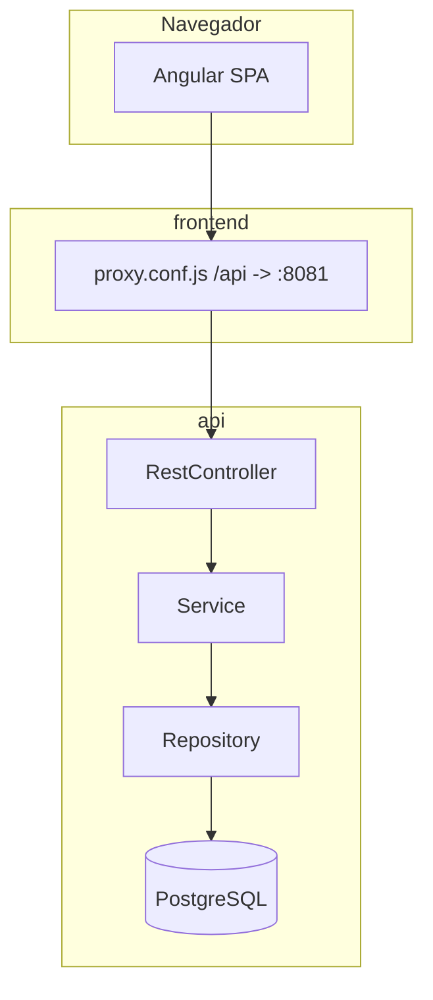

# AppGestion

**Documentación adicional:** [IA de presupuestos](docs/IA-PRESUPUESTOS.md) · [Despliegue en producción](docs/DEPLOY.md) · [API en Vercel](docs/DESPLIEGUE-VERCEL-API.md) · [Enlace público de presupuestos](docs/ENLACE-PUBLICO.md) · [Respuesta del cliente desde el enlace](docs/RESPUESTA-CLIENTE.md) · [Seguimiento automático de presupuestos](docs/SEGUIMIENTO-PRESUPUESTOS.md) · [OAuth correo Gmail/Microsoft (local)](docs/EMAIL-OAUTH-SETUP.md) · [Modelo organización / tenant](docs/TENANT-MODEL.md) · [Dependencias](docs/DEPENDENCIES.md) · [Frontend](frontend/README.md) · [Diagnóstico recuperación de contraseña / correo](docs/TROUBLESHOOTING-PASSWORD-RESET.md) · [Columnas sin uso](docs/DB-UNUSED-COLUMNS.md) · [Nullables intencionales](docs/DB-AUDIT-INTENTIONAL-NULLABLES.md)

### Enlaces públicos de presupuestos

La API ofrece `POST /presupuestos/{id}/enlace` para crear otro enlace por envío, `POST /presupuestos/{id}/enlace/regenerar` para revocarlos todos y crear uno, `DELETE /presupuestos/{id}/enlace` para revocarlos todos y `GET /presupuestos/{id}/enlace/estado` (autenticados), además de `GET /publico/presupuestos/{token}`, `GET /publico/presupuestos/{token}/pdf`, `POST /publico/presupuestos/{token}/visto` y `POST /publico/presupuestos/{token}/responder` (anónimos). Hay un máximo configurable de 10 enlaces activos por presupuesto; volver a enviar no invalida los anteriores.

Configura `app.frontend-url`, `app.public-links.expiry-days` (60 días), `app.public-links.max-active-links` (10), `app.public-links.trusted-proxies` (vacía por defecto), `app.public-links.rate-limit-per-ip` (600/minuto) y `app.public-links.rate-limit-per-token` (60/minuto). Las variables equivalentes son `PUBLIC_BUDGET_LINK_EXPIRY_DAYS`, `PUBLIC_BUDGET_LINK_MAX_ACTIVE`, `PUBLIC_BUDGET_LINK_TRUSTED_PROXIES`, `PUBLIC_BUDGET_LINK_RATE_IP` y `PUBLIC_BUDGET_LINK_RATE_TOKEN`. Por defecto no se confía en `X-Forwarded-For`. El modo de IP del cliente es `app.security.client-ip-mode` (`APP_SECURITY_CLIENT_IP_MODE`: `none`, `trusted-proxies` o `vercel`). El limitador Caffeine es local por instancia. El PDF público solo muestra el nombre del cliente, sin NIF, teléfono, email ni dirección.

Las respuestas anónimas de la API llevan `Cache-Control: no-store`, `X-Robots-Tag: noindex, nofollow` y `Referrer-Policy: no-referrer`. La ruta Angular `/p/:token` publica las meta `robots` y `referrer` equivalentes mientras está abierta. El hosting estático (`frontend/vercel.json` y `frontend/server.mjs`) aplica `Referrer-Policy: strict-origin-when-cross-origin` a todas las rutas. Consulta [el modelo de amenazas, límites, datos expuestos y texto recomendado para privacidad](docs/ENLACE-PUBLICO.md).

**Respuesta del cliente desde el enlace público:** el cliente puede pulsar «Me interesa» o «Tengo dudas» desde `/p/:token`. Es un aviso al contratista, no una aceptación contractual: no cambia el estado del presupuesto. El contratista recibe notificación in-app y email. Consulta [Respuesta del cliente](docs/RESPUESTA-CLIENTE.md).

La API también crea avisos privados de seguimiento para presupuestos enviados y sin resolver. El job se ejecuta cada día a las 09:00 Europe/Madrid; ajusta `APP_PRESUPUESTO_SEGUIMIENTO_CRON` para cambiar la hora. En el perfil `local`, `POST /dev/presupuesto-seguimiento/ejecutar` lanza el job a mano. Consulta [Seguimiento automático de presupuestos](docs/SEGUIMIENTO-PRESUPUESTOS.md).

---

## Descripción

**AppGestion** es un SaaS multiusuario orientado a **autónomos y pequeños negocios** para gestionar **presupuestos**, **facturas**, **clientes**, **gastos** y **catálogo de materiales/servicios**. Cada usuario pertenece a una organización, pero los datos de negocio se filtran hoy por `usuario_id` (el detalle está en [TENANT-MODEL.md](docs/TENANT-MODEL.md)).

En el código se apoya en:

- **Cuenta y seguridad:** registro con verificación de email (el alta con contraseña no devuelve JWT hasta verificar), inicio de sesión (incl. Google, que marca el email como verificado), contraseñas de 12 a 128 caracteres, JWT, sesiones por dispositivo, 2FA TOTP opcional, recuperación de contraseña (el token se guarda como hash SHA-256), invitaciones a organización, auditoría de accesos y cifrado en reposo (AES-GCM) de secretos TOTP, contraseña SMTP y tokens OAuth.
- **Negocio:** CRUD de clientes (incl. cliente provisional), materiales, gastos, presupuestos (ítems, PDF, condiciones, anticipos, enlace público, borrador con IA) y facturas (ítems con tipo de IVA, PDF, cobros parciales, enlaces de pago, recordatorios, envío por correo, anulación y pista de auditoría encadenada).
- **Fiscal:** resumen orientativo de modelo 303 (IVA repercutido y soportado de gastos) y modelo 347, PDF del 303 y plazo fiscal actual.
- **Empresa:** datos de empresa, métodos de cobro, recordatorios, seguimiento de presupuestos, plantillas de PDF, datos fiscales y vista previa de plantillas.
- **Correo:** outbox en base de datos, envío de sistema con Resend y, en su lugar, OAuth Gmail o Microsoft por organización.
- **Panel cliente:** resumen de presupuestos y facturas por cliente.
- **Suscripción:** integración **Stripe** (checkout, portal de cliente, facturas, webhook). Para usuarios de prueba, activa premium con SQL (más abajo). `POST /dev/grant-premium` solo existe si `APP_DEV_GRANT_PREMIUM_ENABLED=true`; el valor por defecto, también en el perfil `local`, es `false`.
- **Soporte y avisos:** contacto a buzón interno (multipart), notificaciones in-app, páginas legales y consentimiento de cookies.
- **Tareas programadas:** recordatorios de factura, seguimiento de presupuestos, caducidad de trial, limpieza de sesiones y de auditoría, worker de la outbox de correo y limpieza de OAuth pendiente. El perfil `serverless` desactiva la limpieza de sesiones y de auditoría.

El arranque local es PostgreSQL, el Maven Wrapper y npm, mediante `start-local.ps1`. El despliegue de la API en Vercel usa `Dockerfile.vercel` y el perfil Spring `serverless`. En ese perfil Flyway no arranca (`spring.flyway.enabled=false`, `ddl-auto: none`). Las migraciones se aplican en un paso previo al despliegue, contra la URL directa de Neon. Guía: [DESPLIEGUE-VERCEL-API.md](docs/DESPLIEGUE-VERCEL-API.md).

---

## Requisitos

Versiones tomadas de `pom.xml`, `api/pom.xml`, `frontend/package.json` y `.nvmrc`:

| Tecnología | Versión / criterio |
|------------|-------------------|
| **Java** | **21** (`java.version` en `pom.xml` raíz) |
| **Spring Boot** | **4.1.0** (parent `spring-boot-starter-parent` en `pom.xml` raíz) |
| **Maven** | **3.9+**, o el **Maven Wrapper** del repo (`mvnw`, `mvnw.cmd`) |
| **Node.js** | **`>=24.14.1`** (`engines` en `frontend/package.json`; `.nvmrc`: `24.14.1`) |
| **Angular** | **^21.2** (`@angular/core` y paquetes alineados en `frontend/package.json`) |
| **Angular CLI** | **^21.2** (`devDependencies`) |
| **TypeScript** | **^6.0** (`frontend/package.json`) |
| **PostgreSQL** | Servidor accesible por JDBC. Por defecto, host `localhost`, puerto **5432** y base **`appgestion`** (`PGHOST`, `PGPORT`, `PGDATABASE` o `SPRING_DATASOURCE_URL`) |

---

## Arquitectura

Monorepo Maven en la raíz de `AppGestion` (`packaging` **pom**) con un módulo **`api`**. El frontend **es una aplicación Angular** en `frontend/` y no es módulo Maven.

Patrón habitual en la API: **capas** `controller` → `service` → `repository` (Spring Data JPA), entidades en `domain/entity`, DTOs en `dto`, configuración en `config`, seguridad en `security`, migraciones **Flyway** en `resources/db/migration`, jobs en `scheduler`.

ArchUnit (`api/src/test/java/com/appgestion/api/unit/architecture/ArchitectureTest.java`) exige que los controllers no dependan de repositorios, que los repositorios no dependan de controllers y que el dominio no dependa de Spring Web.

**Caché in-memory (Caffeine):** `GET /materiales/top-usados` se cachea por **`usuarioId`** (TTL 5 min; invalidación al crear/editar/borrar material). Los cupos de IA también usan Caffeine local por instancia. Sin Redis.



**Estructura real de carpetas (resumen):**

```
AppGestion/
├── pom.xml                      # Parent Maven (módulo api)
├── mvnw, mvnw.cmd               # Maven Wrapper
├── start-local.ps1              # PostgreSQL + API :8081 + frontend :4200
├── Dockerfile.vercel            # Imagen de la API para Vercel
├── api/
│   ├── pom.xml
│   └── src/main/java/com/appgestion/api/
│       ├── config/
│       ├── controller/
│       ├── domain/entity|enums/
│       ├── dto/
│       ├── fiscal/
│       ├── repository/
│       ├── scheduler/
│       ├── security/
│       ├── service/             # incl. email/, crypto/
│       ├── util/
│       └── validation/
│   └── src/main/resources/
│       ├── application.yml
│       └── db/migration/        # Flyway V1..V48
├── frontend/
│   ├── package.json
│   ├── angular.json
│   ├── server.mjs               # servidor estático (Railway / producción)
│   ├── vercel.json
│   ├── proxy.conf.js            # /api -> http://localhost:8081
│   └── src/app/
│       ├── core/
│       ├── features/
│       ├── legal/
│       └── shared/
├── docs/
└── README.md
```

El workflow de CI está en la raíz del repositorio Git, en [`../.github/workflows/ci.yml`](../.github/workflows/ci.yml): `mvn -B -f api/pom.xml verify`, `npm ci`, `npm run build` y `npm audit` del frontend.

---

## Instalación y arranque

### Orden recomendado

1. **PostgreSQL** en ejecución y base de datos creada.
2. **API** (perfil `local`, que aplican el plugin de Maven y `start-local.ps1`).
3. **Frontend** (`frontend/`).
4. **Opcional:** Stripe CLI para webhooks.

### Base de datos

La URL por defecto es `jdbc:postgresql://localhost:5432/appgestion`. El perfil `local` usa `DB_USERNAME` / `DB_PASSWORD` (o `PGUSER` / `PGPASSWORD`) con defecto `postgres` / `postgres`. Fuera de ese perfil las credenciales no tienen valor por defecto.

```sql
CREATE DATABASE appgestion;
```

Hibernate `ddl-auto`: **`validate`** en el perfil base y en `prod`; **`update`** solo en el perfil **`local`**; **`none`** en **`serverless`**. Flyway valida las migraciones por defecto (`FLYWAY_VALIDATE_ON_MIGRATE=true`). El perfil `local` pone `baseline-on-migrate=true` y `validate-on-migrate=false`. El perfil `serverless` deja Flyway apagado.

En Vercel la API habla con el **pooler** de Neon. `SPRING_DATASOURCE_URL` usa el host con `-pooler` y `prepareThreshold=0` (el pooler transaccional no conserva prepared statements). Flyway no usa esa URL: el paso previo al despliegue lee `FLYWAY_URL`, el host **directo** (el mismo endpoint sin `-pooler`). Usuario y contraseña de ese paso son `FLYWAY_USER` y `FLYWAY_PASSWORD`, secretos del CI, no del contenedor. Forma de las URLs, sin credenciales:

```text
SPRING_DATASOURCE_URL=jdbc:postgresql://ep-NOMBRE-pooler.REGION.aws.neon.tech/appgestion?sslmode=require&prepareThreshold=0
FLYWAY_URL=jdbc:postgresql://ep-NOMBRE.REGION.aws.neon.tech/appgestion?sslmode=require
```

### API y frontend a la vez (Windows)

Si estás en la raíz del repositorio `Proyectos`:

```powershell
powershell.exe -NoProfile -ExecutionPolicy Bypass -File .\AppGestion\start-local.ps1
```

Si ya estás dentro de `AppGestion`:

```powershell
powershell.exe -NoProfile -ExecutionPolicy Bypass -File .\start-local.ps1
```

El script comprueba PostgreSQL en `localhost:5432`, pide la contraseña sin mostrarla (Enter usa `postgres`) y arranca API y frontend en segundo plano. Por defecto pide la clave de Gemini y exporta `APP_AI_GEMINI_ENABLED=true`. Añade `-DisableGemini` para arrancar sin IA. Exporta `PORT=8081`, el mismo destino de `frontend/proxy.conf.js`. Si encuentra la API o el frontend de AppGestion en `8081` o `4200`, los reinicia; si el puerto pertenece a otro programa, se detiene sin cerrarlo. Los logs quedan en `api/target/local-api.*.log` y `frontend/target/local-frontend.*.log`.

### API sola

Desde `AppGestion` (el wrapper y `-pl api` se resuelven desde esta carpeta). `PORT=8081` alinea la API con el proxy del frontend y con las redirect URI OAuth por defecto:

```powershell
$env:PORT = "8081"
.\mvnw.cmd -pl api spring-boot:run
```

El `spring-boot-maven-plugin` arranca con perfil **`local`** (JWT de desarrollo, `app.subscription.skip-check: true`, `ddl-auto: update`, CORS ampliado para `:4200`). Sin `PORT`, `application.yml` publica la API en **8080**.

Si ejecutas sin perfil `local`, define al menos **`JWT_SECRET`** (≥32 caracteres).

### Gemini en local

`APP_AI_GEMINI_ENABLED` vale `false` en `application.yml`. `start-local.ps1` lo pone a `true` salvo que pases `-DisableGemini`. Para arrancar solo la API con extracción de gastos y borradores de presupuesto:

```powershell
$env:SPRING_DATASOURCE_URL = "jdbc:postgresql://localhost:5432/appgestion"
$env:DB_USERNAME = "postgres"
$env:DB_PASSWORD = "<contraseña de PostgreSQL>"
$env:PORT = "8081"
$env:APP_AI_GEMINI_ENABLED = "true"
$secureKey = Read-Host "Pega la clave nueva de Gemini (no se mostrará)" -AsSecureString
$keyPointer = [Runtime.InteropServices.Marshal]::SecureStringToBSTR($secureKey)
try {
    $env:GEMINI_API_KEY = [Runtime.InteropServices.Marshal]::PtrToStringBSTR($keyPointer)
} finally {
    [Runtime.InteropServices.Marshal]::ZeroFreeBSTR($keyPointer)
    Remove-Variable secureKey, keyPointer
}
if ([string]::IsNullOrWhiteSpace($env:GEMINI_API_KEY)) { throw "GEMINI_API_KEY está vacío" }
.\mvnw.cmd -pl api spring-boot:run
```

Ejecuta ese bloque desde `AppGestion`, en la misma ventana de PowerShell. Genera la clave en Google AI Studio y no la guardes en el repositorio. Si la API ya estaba en marcha, reiníciala después de definir las variables.

Con la API y el frontend en marcha, **Gastos → Nuevo gasto** acepta una imagen o PDF y **Extraer datos** rellena un borrador editable (`POST /gastos/ia/extraer`). La extracción no guarda el gasto. El borrador de presupuesto es `POST /presupuestos/ia/borrador`: no persiste el presupuesto y los precios salen del texto dictado verificable o del catálogo del usuario. Detalle en [IA-PRESUPUESTOS.md](docs/IA-PRESUPUESTOS.md).

### Frontend (Angular)

Desde `frontend/`:

```powershell
npm install
npm start
```

Equivale a `ng serve --host 0.0.0.0 --port 4200`. Sin CLI global, usa `npx ng serve`.

La SPA queda en **`http://localhost:4200`**. Las peticiones a **`/api/...`** las reenvía `proxy.conf.js` al backend **sin** el prefijo `/api`.

### Referencia de variables de entorno (nombres, sin valores secretos)

Esta tabla es una referencia de nombres. Los comandos anteriores configuran el entorno local. Para producción, define los secretos en la plataforma de despliegue y sigue [Despliegue en producción](docs/DEPLOY.md). La plantilla de nombres está en `.env.example`.

| Variable | Uso |
|----------|-----|
| `SPRING_PROFILES_ACTIVE` | `local`, `prod` y, en Vercel, `prod,serverless` |
| `PORT` | Puerto HTTP. Defecto del yml: `8080`. `start-local.ps1` y el proxy usan `8081` |
| `SPRING_DATASOURCE_URL` | JDBC de la API. Si falta, se compone con `PGHOST`, `PGPORT` y `PGDATABASE`. En Vercel: host Neon con `-pooler`, `sslmode=require` y `prepareThreshold=0` |
| `FLYWAY_URL` | JDBC directa de Neon, sin `-pooler`. Solo el paso de migración previo al despliegue. El proceso `serverless` no la lee |
| `FLYWAY_USER`, `FLYWAY_PASSWORD` | Usuario y contraseña de `FLYWAY_URL`. Secretos del CI, no van en el repositorio ni en el contenedor de Vercel |
| `DB_USERNAME`, `DB_PASSWORD`, `PGUSER`, `PGPASSWORD` | Credenciales PostgreSQL de la API. Defecto `postgres`/`postgres` solo en perfil `local` |
| `JWT_SECRET` | Obligatorio fuera de `local` (≥32 caracteres) |
| `CORS_ALLOWED_ORIGINS`, `CORS_ALLOWED_ORIGIN_PATTERNS` | Orígenes CORS |
| `FRONTEND_URL` | URL del front. En `prod`, defecto `https://noemiweb.com` |
| `APP_AI_GEMINI_ENABLED` | `true` activa extracción de gastos y borradores de presupuesto. Defecto `false` |
| `GEMINI_API_KEY` | Obligatoria si Gemini está activado |
| `APP_AI_GEMINI_MODEL` | Defecto `gemini-3.5-flash-lite` |
| `APP_AI_GEMINI_REQUESTS_PER_HOUR` | Cupo horario de borradores Gemini por usuario e instancia. Defecto `20` |
| `APP_AI_PRESUPUESTO_REQUESTS_PER_DAY` | Cupo diario de borradores de presupuesto. Defecto `20` |
| `APP_AI_GEMINI_MAX_ATTEMPTS_PER_HOUR` | Intentos HTTP a Gemini (éxitos, fallos y reintentos). Defecto `60` |
| `APP_AI_EVAL_GEMINI` | Solo tests: con `true` habilita `PresupuestoIaGeminiEvaluationTest` |
| `APP_EMAIL_TOKEN_SECRET` | Clave de cifrado en reposo (TOTP, SMTP, OAuth). El perfil `local` trae un valor de desarrollo |
| `APP_EMAIL_TOKEN_SECRET_PREVIOUS` | Clave anterior, solo durante una rotación |
| `APP_EMAIL_SYSTEM_FROM` | Remitente del correo de sistema (Resend) |
| `APP_EMAIL_DAILY_SEND_QUOTA` | Tope diario de correos a terceros por usuario. Defecto `200`; `0` lo quita |
| `RESEND_API_KEY`, `RESEND_WEBHOOK_SECRET` | API Resend y firma Svix del webhook |
| `MAIL_HOST`, `MAIL_PORT`, `MAIL_USERNAME`, `MAIL_PASSWORD` | SMTP legado (`spring.mail.*`) |
| `GOOGLE_LOGIN_CLIENT_IDS` | Audiencias aceptadas en `POST /auth/google` |
| `GOOGLE_OAUTH_*`, `MICROSOFT_OAUTH_*` | OAuth de envío Gmail/Microsoft. Ver [EMAIL-OAUTH-SETUP.md](docs/EMAIL-OAUTH-SETUP.md) |
| `STRIPE_SECRET_KEY`, `STRIPE_WEBHOOK_SECRET`, `STRIPE_PRICE_MONTHLY`, `STRIPE_PRICE_YEARLY` | Stripe |
| `STRIPE_SUCCESS_URL`, `STRIPE_CANCEL_URL`, `STRIPE_SUBSCRIPTION_CANCEL_URL`, `STRIPE_PORTAL_RETURN_URL` | URLs de retorno |
| `STRIPE_CHECKOUT_AUTOMATIC_TAX` | Stripe Tax en el checkout. Defecto `false` |
| `SUBSCRIPTION_DISPLAY_MONTHLY_EUR`, `SUBSCRIPTION_DISPLAY_YEARLY_EUR` | Precios mostrados en `GET /subscription/details` |
| `SUPPORT_INBOX_EMAIL` | Buzón del formulario de soporte. Sin valor, el formulario no envía |
| `TOTP_ISSUER` | Nombre del emisor TOTP. Defecto `AppGestion` |
| `PUBLIC_BUDGET_LINK_*` | Caducidad, máximo de enlaces, proxies y rate limit del enlace público |
| `APP_SECURITY_CLIENT_IP_MODE`, `APP_SECURITY_TRUSTED_PROXIES` | Resolución de IP (`none`, `trusted-proxies`, `vercel`) |
| `APP_PRESUPUESTO_SEGUIMIENTO_CRON` | Cron diario (`0 0 9 * * ?`); zona Europe/Madrid |
| `APP_PRESUPUESTO_SEGUIMIENTO_LOCAL_DAYS_OVERRIDE` | Solo perfil `local`: días de espera al ejecutar a mano. Defecto `0` |
| `APP_DEV_GRANT_PREMIUM_ENABLED` | Activa `POST /dev/grant-premium`. Defecto `false` |
| `SESSIONS_CLEANUP_*`, `AUDIT_*`, `APP_SESSIONS_ANONYMIZE_IP` | Retención y anonimización de IP |
| `FLYWAY_VALIDATE_ON_MIGRATE`, `FLYWAY_BASELINE_ON_MIGRATE` | Comportamiento de Flyway |

#### Producción

Las instrucciones de publicación, variables obligatorias, CORS y secretos están en [Despliegue en producción](docs/DEPLOY.md) y [API en Vercel](docs/DESPLIEGUE-VERCEL-API.md).

### Webhook Stripe (opcional)

```bash
stripe listen --forward-to localhost:8081/webhook/stripe
```

Configura `STRIPE_WEBHOOK_SECRET` con el `whsec_...` que muestre Stripe. Con el secreto vacío, el webhook rechaza los eventos.

### Mensual y anual en la pasarela Stripe (upsell)

El checkout abre con el **precio mensual** cuando existen `STRIPE_PRICE_MONTHLY` y `STRIPE_PRICE_YEARLY`. Para que el cliente vea **ambas opciones dentro de Stripe Checkout**, configura un **subscription upsell** en el Dashboard:

1. **Productos** → tu plan → abre el **precio mensual** (`STRIPE_PRICE_MONTHLY`).
2. En **Upsells**, elige el precio anual (`STRIPE_PRICE_YEARLY`).
3. Ambos precios deben ser del **mismo producto**, misma moneda y tipo recurrente.

Documentación: [Stripe subscription upsells](https://docs.stripe.com/payments/checkout/upsells).

---

## Tests

| Módulo | Comando | Runner / notas |
|--------|---------|----------------|
| **API** | `.\mvnw.cmd -pl api test` desde `AppGestion`, o `mvn test` desde `api/` | JUnit 5, Mockito, ArchUnit. CI usa `mvn -B -f api/pom.xml verify` |
| **Frontend** | `npm test` desde `frontend/` | Vitest vía `ng test` (`@angular/build:unit-test`) |

La mayoría de tests de API usan el perfil `test` con **H2 en memoria** (`application-test.properties`: Flyway desactivado, `ddl-auto=create-drop`). `PostgresFlywayValidationTest` arranca **PostgreSQL 16** con Testcontainers y se omite si no hay Docker.

El frontend cubre auth, cálculos de presupuesto y cobro, servicios HTTP, i18n y piezas de cuenta, gastos, fiscal y consentimiento de cookies.

---

## API REST

Prefijos **tal como los expone el backend** (sin `/api`; el front añade `/api` y el proxy lo quita).

### Autenticación y cuenta (`/auth`)

| Método | Ruta | Descripción breve |
|--------|------|-------------------|
| POST | `/auth/register` | Alta. No devuelve JWT: queda pendiente de verificar el email |
| POST | `/auth/verify-email` | Confirma el email con el token del correo |
| POST | `/auth/resend-verification` | Reenvía la verificación. No revela si la cuenta existe |
| POST | `/auth/login` | Login. Rechaza la cuenta si el email no está verificado |
| POST | `/auth/google` | Login con Google (el email queda verificado) |
| GET | `/auth/me` | Usuario actual |
| PATCH | `/auth/profile` | Actualizar perfil |
| PATCH | `/auth/account-settings` | Ajustes de cuenta |
| PATCH | `/auth/preferences` | Preferencias |
| POST | `/auth/change-password` | Cambiar contraseña |
| POST | `/auth/totp/setup/start` | Iniciar configuración TOTP |
| POST | `/auth/totp/setup/confirm` | Confirmar TOTP |
| POST | `/auth/totp/setup/cancel` | Cancelar configuración TOTP |
| POST | `/auth/totp/disable` | Desactivar TOTP |
| POST | `/auth/forgot-password` | Solicitar reset de contraseña |
| POST | `/auth/reset-password` | Restablecer contraseña |
| POST | `/auth/invitations` | Crear invitación (roles ADMIN/USER) |
| GET | `/auth/invite/verify` | Verificar token de invitación; JSON con único campo `valid`; no devuelve email |
| POST | `/auth/invite/accept` | Aceptar invitación |
| GET | `/auth/sessions` | Listar sesiones/dispositivos |
| DELETE | `/auth/sessions/{sessionId}` | Revocar sesión |
| DELETE | `/auth/sessions/others` | Revocar otras sesiones |
| POST | `/auth/logout` | Cerrar sesión actual |

**Referidos y enlace de invitación**

- El correo de referido apunta al front en **`https://noemiweb.com/login?ref=<token>`**. La ruta antigua `/invite/:token` redirige ahí. El usuario elige el email en **`https://noemiweb.com/register?ref=<token>`**.
- **`GET /auth/invite/verify?token=...`** (público): **`{ "valid": true|false }`**.
- **`POST /auth/register`**: cuerpo opcional **`referralToken`** (el mismo valor que `ref`). Si es válido, el backend registra el referido. La cuenta nueva sigue su propia organización.

### Correo OAuth (`/auth/email/oauth`)

| Método | Ruta | Descripción breve |
|--------|------|-------------------|
| GET | `/auth/email/oauth/status` | Estado de la conexión |
| GET | `/auth/email/oauth/google/authorize-url` | URL de autorización Gmail |
| GET | `/auth/email/oauth/google/callback` | Callback Google |
| GET | `/auth/email/oauth/microsoft/authorize-url` | URL de autorización Microsoft |
| GET | `/auth/email/oauth/microsoft/callback` | Callback Microsoft |
| DELETE | `/auth/email/oauth/disconnect` | Desconectar el buzón |

### Soporte, notificaciones y auditoría

| Método | Ruta | Descripción breve |
|--------|------|-------------------|
| POST | `/auth/support/contact` | Contacto soporte (multipart) |
| GET | `/auth/notifications` | Listar notificaciones |
| GET | `/auth/notifications/unread-count` | Contador no leídas |
| PATCH | `/auth/notifications/{id}/read` | Marcar como leída |
| POST | `/auth/notifications/read-all` | Marcar todas leídas |
| GET | `/auth/audit-access` | Listado auditoría de accesos |
| GET | `/auth/audit-access/export` | Exportar auditoría |

### Clientes (`/clientes`)

| Método | Ruta | Descripción breve |
|--------|------|-------------------|
| GET | `/clientes` | Listar |
| GET | `/clientes/{id}` | Detalle |
| GET | `/clientes/{id}/panel` | Panel resumen cliente |
| POST | `/clientes/provisional` | Alta mínima (cliente provisional) |
| PUT | `/clientes/{id}/completar` | Completar un cliente provisional |
| POST | `/clientes` | Crear |
| PUT | `/clientes/{id}` | Actualizar |
| DELETE | `/clientes/{id}` | Eliminar |

### Materiales (`/materiales`)

| Método | Ruta | Descripción breve |
|--------|------|-------------------|
| GET | `/materiales` | Listar |
| GET | `/materiales/top-usados` | Más usados en presupuestos (caché Caffeine 5 min por usuario) |
| GET | `/materiales/{id}` | Detalle (id numérico) |
| POST | `/materiales` | Crear |
| PUT | `/materiales/{id}` | Actualizar |
| DELETE | `/materiales/{id}` | Eliminar |

### Gastos (`/gastos`)

Registro de compras/gastos con IVA soportado. La cuota del trimestre entra en **`GET /fiscal/modelo303`** (`ivaSoportado`). Aislamiento por `usuario_id`. Se pueden filtrar por presupuesto y asociar a uno.

| Método | Ruta | Descripción breve |
|--------|------|-------------------|
| GET | `/gastos` | Listar (query opcional `presupuestoId`) |
| GET | `/gastos/{id}` | Detalle |
| POST | `/gastos/ia/extraer` | Borrador desde imagen o PDF (multipart). No persiste |
| POST | `/gastos` | Crear |
| PUT | `/gastos/{id}` | Actualizar |
| PATCH | `/gastos/{id}/presupuesto` | Asociar o desasociar un presupuesto |
| DELETE | `/gastos/{id}` | Eliminar |

### Presupuestos (`/presupuestos`)

| Método | Ruta | Descripción breve |
|--------|------|-------------------|
| GET | `/presupuestos` | Listar |
| GET | `/presupuestos/{id}` | Detalle |
| POST | `/presupuestos` | Crear |
| PUT | `/presupuestos/{id}` | Actualizar |
| PATCH | `/presupuestos/{id}/estado` | Cambiar estado |
| DELETE | `/presupuestos/{id}` | Eliminar |
| GET | `/presupuestos/{id}/pdf` | PDF |
| POST | `/presupuestos/{id}/enviar-email` | Enviar por email |
| POST | `/presupuestos/{id}/marcar-enviado` | Marcar como enviado |
| POST | `/presupuestos/ia/borrador` | Borrador editable desde texto; sin persistencia |
| POST | `/presupuestos/{id}/factura` | Factura desde presupuesto |
| POST | `/presupuestos/{id}/anticipo` | Registrar anticipo |
| GET | `/presupuestos/{id}/resumen-anticipo` | Resumen del anticipo |
| POST | `/presupuestos/{id}/factura-anticipo` | Factura del anticipo |
| POST | `/presupuestos/{id}/factura-final` | Factura final |
| POST | `/presupuestos/{id}/enlace` | Nuevo enlace público |
| POST | `/presupuestos/{id}/enlace/regenerar` | Revocar y crear uno |
| DELETE | `/presupuestos/{id}/enlace` | Revocar enlaces |
| GET | `/presupuestos/{id}/enlace/estado` | Estado de los enlaces |
| POST | `/presupuestos/{id}/seguimiento/silenciar` | Silenciar avisos |
| DELETE | `/presupuestos/{id}/seguimiento/silenciar` | Reactivar seguimiento |
| GET | `/presupuestos/condiciones-disponibles` | Catálogo de condiciones |
| GET | `/presupuestos/mis-condiciones-predeterminadas` | Condiciones por defecto del usuario |
| PUT | `/presupuestos/mis-condiciones-predeterminadas` | Guardar condiciones por defecto |

Público (sin JWT): `GET /publico/presupuestos/{token}`, `GET /publico/presupuestos/{token}/pdf`, `POST /publico/presupuestos/{token}/visto`, `POST /publico/presupuestos/{token}/responder`.

### Facturas (`/facturas`)

| Método | Ruta | Descripción breve |
|--------|------|-------------------|
| GET | `/facturas` | Listar |
| GET | `/facturas/{id}` | Detalle |
| GET | `/facturas/{id}/pdf` | PDF |
| POST | `/facturas` | Crear |
| PUT | `/facturas/{id}` | Actualizar |
| PATCH | `/facturas/{id}/estado-pago` | Estado de pago |
| POST | `/facturas/{id}/cobros` | Registrar cobro |
| POST | `/facturas/{id}/payment-link` | Enlace de pago |
| POST | `/facturas/{id}/recordatorio/cobro` | Recordatorio de cobro |
| POST | `/facturas/{id}/enviar-email` | Enviar por email |
| POST | `/facturas/{id}/anular` | Anular (no hay `DELETE`) |

Los cambios relevantes quedan en `factura_auditoria` (hash encadenado por factura, V48).

### Fiscal (`/fiscal`)

| Método | Ruta | Descripción breve |
|--------|------|-------------------|
| GET | `/fiscal/plazo-actual` | Plazo fiscal en curso |
| GET | `/fiscal/modelo303` | Resumen orientativo del modelo 303 |
| GET | `/fiscal/modelo303/pdf` | PDF del resumen 303 |
| GET | `/fiscal/modelo347` | Resumen orientativo del modelo 347 |

### Configuración empresa (`/config`)

| Método | Ruta | Descripción breve |
|--------|------|-------------------|
| GET | `/config/empresa` | Datos empresa |
| PUT | `/config/empresa` | Actualizar empresa |
| PATCH | `/config/empresa/metodos-cobro` | Métodos de cobro |
| PATCH | `/config/empresa/recordatorios-cobro` | Recordatorios cobro |
| GET | `/config/empresa/seguimiento-presupuestos` | Preferencias de seguimiento |
| PATCH | `/config/empresa/seguimiento-presupuestos` | Actualizar preferencias de seguimiento |
| PATCH | `/config/empresa/datos-fiscales` | Datos fiscales |
| PATCH | `/config/empresa/plantillas-pdf` | Plantillas PDF |
| POST | `/config/empresa/plantillas-pdf/preview` | Vista previa PDF plantillas |

### Suscripción y webhooks

| Método | Ruta | Descripción breve |
|--------|------|-------------------|
| GET | `/subscription/details` | Estado y precios mostrados |
| POST | `/subscription/checkout` | Checkout Stripe (precio mensual; mensual/anual en pasarela si el upsell está configurado) |
| GET | `/subscription/invoices` | Facturas Stripe |
| POST | `/subscription/portal` | Portal cliente Stripe |
| POST | `/webhook/stripe` | Webhook Stripe. Sin `STRIPE_WEBHOOK_SECRET` rechaza el evento |
| POST | `/webhook/resend` | Webhook Resend. Con `RESEND_WEBHOOK_SECRET` valida la firma Svix (`svix-*`) |

### Solo desarrollo

| Método | Ruta | Descripción breve |
|--------|------|-------------------|
| POST | `/dev/grant-premium` | Marca al usuario autenticado como `ACTIVE`. Solo si `APP_DEV_GRANT_PREMIUM_ENABLED=true` |
| POST | `/dev/presupuesto-seguimiento/ejecutar` | Ejecuta el seguimiento a mano. Solo perfil `local` |

### Premium de prueba por base de datos

```sql
UPDATE usuarios
SET subscription_status = 'ACTIVE',
    stripe_customer_id = NULL,
    stripe_subscription_id = NULL,
    stripe_price_id = NULL,
    subscription_current_period_end = NULL,
    subscription_cancel_at_period_end = false,
    subscription_requires_payment_action = false
WHERE lower(email) = lower('tu@email.com');
```

Luego cierra sesión y vuelve a entrar, o refresca `/auth/me`, para que el frontend reciba `canWrite=true`.

---

## Funcionalidades (código)

Servicios y piezas de apoyo:

- **Auth:** `AuthService`, `EmailVerificationService`, `PasswordResetService`, `SessionService`, `InvitacionService`, `CurrentUserService`, `JwtService`, `TotpService`, `TotpVerificationService`
- **Organización:** `OrganizationService`
- **Clientes:** `ClienteService`, `ClientePanelService`
- **Materiales y gastos:** `MaterialService`, `GastoService`, `GastoIaService`
- **Presupuestos:** `PresupuestoService`, `PresupuestoIaService`, `PresupuestoPdfService`, `PresupuestoCondicionesService`, `PresupuestoSeguimientoService`, `PresupuestoRespuestaClienteService`, `PublicBudgetLinkService`, `AnticipoService`, `PlantillasPdfPreviewService`
- **Facturas:** `FacturaService`, `FacturaPdfService`, `FacturaNumeroService`, `FacturaCobroService`, `FacturaEmailService`, `FacturaPaymentLinkService`, `FacturaRecordatorioService`, `FacturaRecordatorioClienteService`, `FacturaAuditoriaService`
- **Fiscal:** `FiscalService`, `FiscalPdfService`, `FiscalPlazosService`
- **Empresa y correo:** `EmpresaService`, `EmailService`, `EmailOutboxService`, `EmailJobWorker`, `EmailDispatchService`, `EmailOAuthService`, `SupportService`
- **Cifrado:** `TokenEncryptionService`, `EncryptedStringConverter`
- **Suscripción:** `SubscriptionService`, `StripeService`, `StripeWebhookService`
- **Notificaciones y auditoría:** `NotificacionService`, `AuditAccessService`, `AuditAccessCleanupService`
- **Sesiones:** `UsuarioSesionCleanupService`
- **Utilidades frontend (`core/utils/`):** `presupuesto-costes.util`, `factura-cobro.util`
- **Utilidad API:** `WhatsAppLinkService`

**Config relevante:** `CacheConfig` (Caffeine), `SecurityConfig`, `GlobalExceptionHandler`.

**Schedulers:** `FacturaRecordatorioJob`, `PresupuestoSeguimientoJob`, `TrialExpirationJob`, `UsuarioSesionCleanupJob`, `AuditAccessCleanupJob`, `EmailJobWorker`, `OauthPendingCleanup`.

---

## Base de datos (Flyway)

Migraciones en `api/src/main/resources/db/migration/` (**V1** a **V48**). Las recientes:

- **V43:** respuesta del cliente en el enlace público
- **V44:** `enlace_visto_notificado`
- **V45:** `app_migration_state` (migraciones de aplicación, p. ej. en arranque serverless)
- **V46:** `factura_items.tipo_iva` (21, 10, 4 o 0). Hay un precheck en `db/verification/V46_tipo_iva_precheck.sql`
- **V47:** columnas más largas para secretos cifrados, hash del token de reset y verificación de email (las cuentas ya existentes quedan verificadas)
- **V48:** `factura_auditoria` con hash encadenado

`V38` añadió `presupuestos.foto_trabajo` y `presupuestos.firma_cliente`; el código actual no las usa. Ver [DB-UNUSED-COLUMNS.md](docs/DB-UNUSED-COLUMNS.md).

Hibernate `ddl-auto`: **`validate`** por defecto y en `prod`; **`update`** solo en el perfil **`local`**.

---

## Dependencias y licencia

- Detalle de librerías: [`docs/DEPENDENCIES.md`](docs/DEPENDENCIES.md) y [`frontend/README.md`](frontend/README.md).
- **Documentación:** mantener alineadas versiones con `pom.xml`, `frontend/package.json` y migraciones Flyway (`db/migration/`).
- **Licencia:** proyecto privado.
